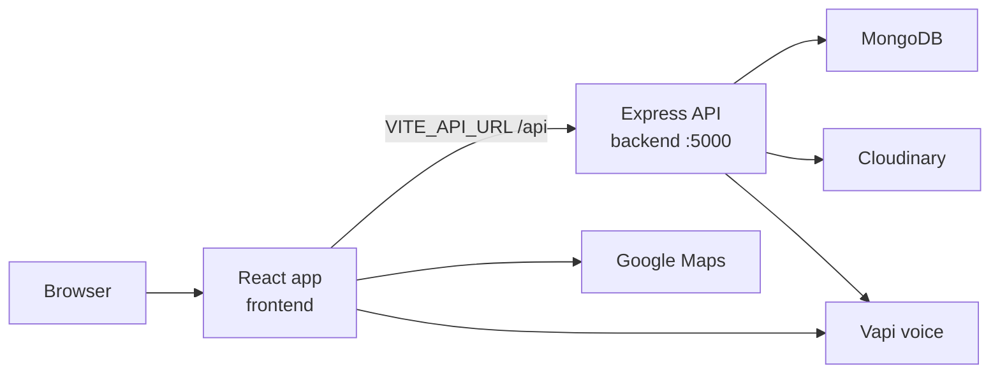
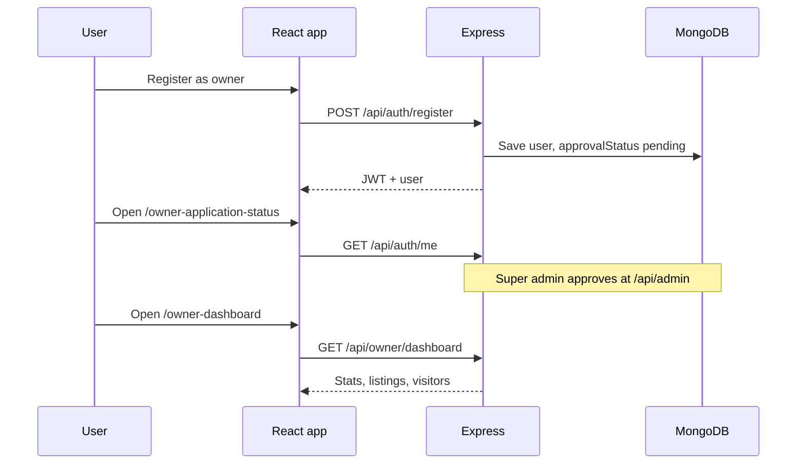

# Broget Home Estate

Property listing site for buy, rent, and PG homes. Visitors search listings, save favourites, and send enquiries. Owners apply to post properties. A super admin approves those applications.

The app is two projects:

- `frontend`: React + Vite single-page app
- `backend`: Express API on MongoDB

## How it fits together



A page load stays in the browser. Data calls go to the API. The API checks the JWT, reads or writes MongoDB, and uses Cloudinary when an owner uploads photos.



## Tech stack

| Layer | Tools |
|---|---|
| UI | React 19, React Router 7, Axios, Vite 8 |
| API | Express 5, JWT, bcrypt |
| Data | MongoDB, Mongoose |
| Media | Cloudinary, Multer |
| Maps | Google Maps JavaScript API |
| Voice | Vapi (`@vapi-ai/web` in the browser, private key on the API) |

## File structure

```text
brogetbuilder/
├── backend/
│   ├── config/
│   │   ├── db.js                  MongoDB connection
│   │   └── cloudinary.js          Cloudinary client
│   ├── middleware/
│   │   ├── authMiddleware.js      Verifies Bearer JWT
│   │   ├── requireApprovedOwner.js
│   │   ├── requireSuperAdmin.js
│   │   └── ownerMiddleware.js
│   ├── models/
│   │   ├── User.js                user, owner, superadmin
│   │   ├── Property.js
│   │   ├── Project.js
│   │   ├── Enquiry.js
│   │   ├── Testimonial.js
│   │   ├── PropertyVisit.js
│   │   └── Owner.js
│   ├── routes/
│   │   ├── authRoutes.js
│   │   ├── PropertyRoutes.js
│   │   ├── projectRoutes.js
│   │   ├── enquiryRoutes.js
│   │   ├── favouriteRoutes.js
│   │   ├── visitRoutes.js
│   │   ├── ownerRoutes.js
│   │   ├── publicOwnerRoutes.js
│   │   ├── superAdminRoutes.js
│   │   ├── uploadRoutes.js
│   │   ├── testimonialRoutes.js
│   │   ├── loanRoutes.js
│   │   └── aiCallRoutes.js
│   ├── scripts/
│   │   └── createSuperAdmin.js
│   ├── seed.js                    Sample properties
│   ├── seedProjects.js            Sample projects
│   ├── server.js                  App entry, mounts /api routes
│   └── package.json
│
└── frontend/
    ├── public/                    favicon and icons
    ├── src/
    │   ├── components/            Navbar, cards, search, chat, maps, loan calc
    │   ├── pages/                 One screen per route
    │   ├── App.jsx                Route table
    │   ├── main.jsx               BrowserRouter mount
    │   └── config.js              API_URL from VITE_API_URL
    ├── vercel.json                SPA fallback to index.html
    ├── .env.example
    ├── index.html
    ├── vite.config.js
    └── package.json
```

`frontend/src/pages` maps one file to one screen: `Home.jsx`, `PropertyDetails.jsx`, `PostProperty.jsx`, `OwnerDashboard.jsx`, `SuperAdminPanel.jsx`, category pages (`Apartments.jsx`, `Villas.jsx`, `Plots.jsx`, `IndependentHouses.jsx`, `BuilderFloors.jsx`), and static pages (`AboutUs.jsx`, `ContactUs.jsx`, `WhyChooseUs.jsx`, `PropertyNews.jsx`). Property news is stored in the browser, not in MongoDB.

## Roles

| Role | What they can do |
|---|---|
| `user` | Browse, favourite, enquire, request a visit |
| `owner` | Same as a user. Dashboard and posting open after `approvalStatus` is `approved` |
| `superadmin` | Review owner applications and testimonials |

Owner signup sets `approvalStatus` to `pending`. `/api/owner/*` rejects pending and rejected owners. Super admin approve and reject live under `/api/admin/owner-applications/:id`.

## Frontend routes

| Path | Screen |
|---|---|
| `/` | All listings |
| `/buy`, `/rent`, `/pg` | Listings filtered by type |
| `/apartments`, `/villas`, `/plots`, `/independent-houses`, `/builder-floors` | Category listings |
| `/property/:id` | Property details, enquiry, loan calculator, AI call |
| `/new-projects`, `/project/:id` | Builder projects |
| `/post-property` | Owner listing form |
| `/favourites` | Saved properties |
| `/owners/:ownerId/properties` | Public owner listings |
| `/login`, `/register` | Auth |
| `/owner-dashboard` | Approved owner home |
| `/owner-application-status` | Pending or rejected owner |
| `/super-admin` | Admin panel |
| `/about-us`, `/about`, `/why-choose-us`, `/contact-us` | Static pages |
| `/property-news`, `/property-news/:slug` | Local articles |

## API

Base URL locally: `http://localhost:5000/api`

| Method | Path | Access |
|---|---|---|
| POST | `/auth/register` | Public |
| POST | `/auth/login` | Public |
| GET | `/auth/me` | Logged in |
| GET | `/properties` | Public |
| GET | `/properties/featured/list` | Public |
| GET | `/properties/similar/:id` | Public |
| GET | `/properties/:id` | Public |
| POST | `/properties` | Create listing |
| PUT | `/properties/:id` | Update listing |
| DELETE | `/properties/:id` | Delete listing |
| GET | `/projects` | Public |
| GET | `/projects/featured/list` | Public |
| GET | `/projects/:id` | Public |
| POST | `/projects` | Create project |
| PUT | `/projects/:id` | Update project |
| DELETE | `/projects/:id` | Delete project |
| POST | `/enquiries` | Public |
| GET | `/enquiries` | List enquiries |
| GET | `/favourites` | Logged in |
| GET | `/favourites/check/:propertyId` | Logged in |
| POST | `/favourites/:propertyId` | Logged in |
| DELETE | `/favourites/:propertyId` | Logged in |
| POST | `/visits/:propertyId` | Logged in |
| GET | `/public/owners` | Public |
| GET | `/public/owners/:ownerId/properties` | Public |
| GET | `/owner/dashboard` | Approved owner |
| GET | `/owner/properties` | Approved owner |
| GET | `/owner/visitors` | Approved owner |
| GET | `/owner/customers` | Approved owner |
| GET | `/admin/stats` | Super admin |
| GET | `/admin/users` | Super admin |
| GET | `/admin/owner-applications` | Super admin |
| PATCH | `/admin/owner-applications/:id/approve` | Super admin |
| PATCH | `/admin/owner-applications/:id/reject` | Super admin |
| POST | `/uploads` | Up to 10 images |
| GET | `/testimonials` | Approved reviews |
| POST | `/testimonials` | Submit a review |
| GET | `/testimonials/admin/pending` | Super admin |
| PATCH | `/testimonials/admin/:id/review` | Super admin |
| GET | `/loans/banks` | Public |
| POST | `/ai-calls/property-call` | Public, needs Vapi env |
| GET | `/` | Health text on the server root, not under `/api` |

## Run locally

Use two terminals. Node 20.19 or newer.

**API**

```bash
cd backend
npm install
```

Create `backend/.env`:

```env
PORT=5000
MONGO_URI=mongodb://127.0.0.1:27017/broget
JWT_SECRET=replace-with-a-long-random-secret
CLOUDINARY_CLOUD_NAME=
CLOUDINARY_API_KEY=
CLOUDINARY_API_SECRET=
VAPI_PRIVATE_KEY=
VAPI_ASSISTANT_ID=
VAPI_PHONE_NUMBER_ID=
SUPERADMIN_NAME=
SUPERADMIN_EMAIL=
SUPERADMIN_PASSWORD=
```

```bash
npm run dev
node seed.js
npm run seed-projects
node scripts/createSuperAdmin.js
```

`seed.js` replaces existing properties. `createSuperAdmin.js` refuses to reuse an email that already exists, and the password must be at least 12 characters.

**App**

```bash
cd frontend
npm install
cp .env.example .env
npm run dev
```

The dev server is Vite’s default, `http://localhost:5173`. `VITE_API_URL` defaults to `http://localhost:5000/api` when `.env` is missing.

| Variable | Used for |
|---|---|
| `VITE_API_URL` | API base, include `/api` |
| `VITE_GOOGLE_MAPS_API_KEY` | Location autocomplete |
| `VITE_VAPI_PUBLIC_KEY` | In-browser voice call |
| `VITE_VAPI_ASSISTANT_ID` | Vapi assistant |

## Deploy the frontend on Vercel

In the Vercel project:

- Root Directory: `frontend`
- Framework: Vite
- Build command: `npm run build`
- Output directory: `dist`

Set the same `VITE_*` variables in Vercel, with `VITE_API_URL` pointing at the deployed API (still ending in `/api`). Redeploy after changing them. Vite reads env vars at build time.

`frontend/vercel.json` rewrites every path to `index.html`, so routes such as `/property/:id` keep working on refresh.

Set the API `CORS_ORIGIN` to the Vercel domain before the live site calls the API. Leave `CORS_ORIGIN` empty only for local development, where every origin is allowed.

## Deploy the API on Railway

Create a Railway service from this repo and set **Root Directory** to `backend`. Railpack installs from `backend/package-lock.json` and runs `npm start`. The process listens on `0.0.0.0` and Railway's `PORT`, and it does not accept traffic until MongoDB is connected.

In the service settings, set **Healthcheck Path** to `/health`.

Set these variables on the service. Do not commit them.

| Variable | Required | Used for |
|---|---|---|
| `MONGO_URI` | Yes | Atlas connection string |
| `JWT_SECRET` | Yes | Signing login tokens |
| `CORS_ORIGIN` | Yes in production | Comma-separated frontend origins, no trailing slash |
| `CLOUDINARY_CLOUD_NAME` | For photo upload | Cloudinary |
| `CLOUDINARY_API_KEY` | For photo upload | Cloudinary |
| `CLOUDINARY_API_SECRET` | For photo upload | Cloudinary |
| `VAPI_PRIVATE_KEY` | For voice calls | Vapi |
| `VAPI_ASSISTANT_ID` | For voice calls | Vapi |
| `VAPI_PHONE_NUMBER_ID` | For voice calls | Vapi |

Example:

```env
CORS_ORIGIN=https://your-app.vercel.app,http://localhost:5173
```

In Atlas **Network Access**, allow Railway to reach the cluster. A fixed IP is not available on every Railway plan, so `0.0.0.0/0` is the setting that keeps the deployed API connected. The database user still needs its own password.

`.railway/railway.ts` describes this service (`rootDirectory: backend`, start `npm start`, healthcheck `/health`). Apply it with the Railway CLI after `railway login` and `railway link`:

```bash
railway config plan
railway config apply
```

Railway still injects `MONGO_URI`, `JWT_SECRET`, and the other secrets in the dashboard. Those values stay out of git.

## Scripts

| Where | Command | What it does |
|---|---|---|
| `frontend` | `npm run dev` | Vite dev server |
| `frontend` | `npm run build` | Production bundle in `frontend/dist` |
| `frontend` | `npm run preview` | Serve the production bundle |
| `frontend` | `npm run lint` | ESLint |
| `backend` | `npm run dev` | API with nodemon |
| `backend` | `npm start` | API with node |
| `backend` | `npm run seed-projects` | Insert sample projects |
